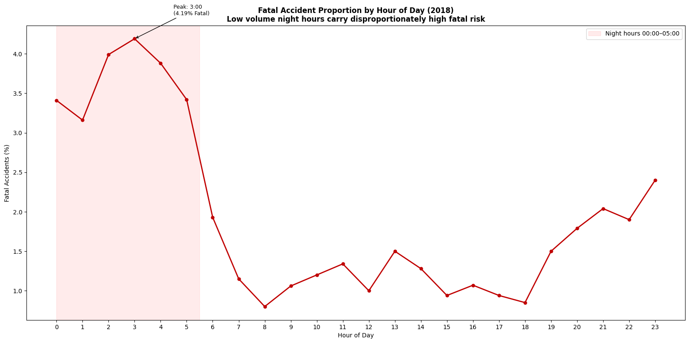
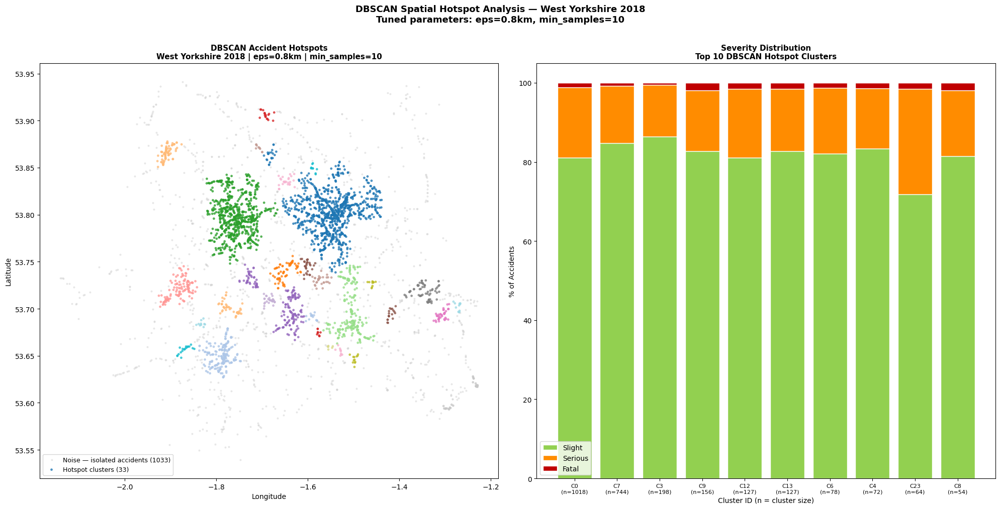
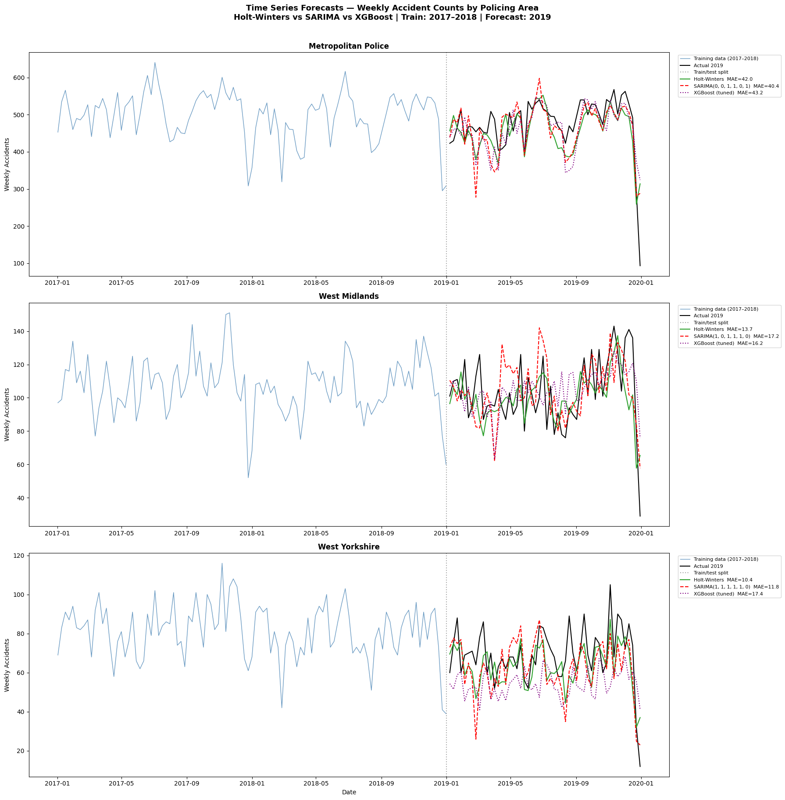
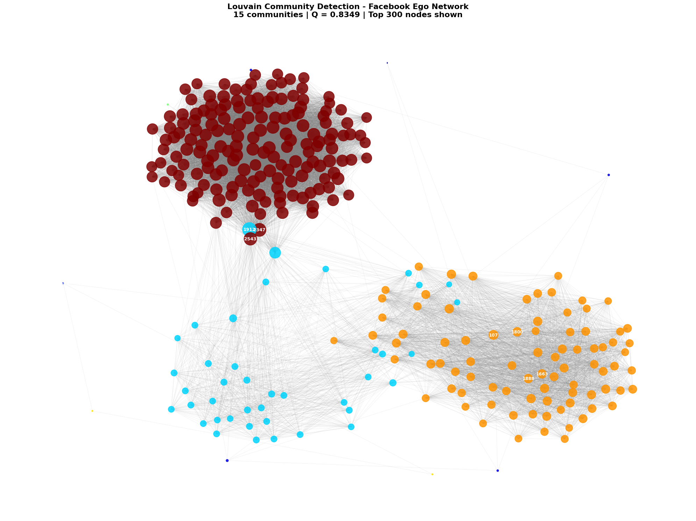

# UK Road Accident Analysis and Facebook Network Analysis

Two data mining projects from my MSc (Big Data and Data Mining module, University of Hull):

1. **UK road accidents:** temporal patterns, association rule mining, spatial clustering and time-series forecasting on 461,352 STATS19 accident records.
2. **Facebook social network:** network statistics, centrality, edge betweenness and community detection on a 4,039-user friendship network.

## Part 1: UK road accidents (STATS19, 2017–2019)

### Key findings

| Area | Finding |
|---|---|
| **Timing** | Accidents peak at 17:00 (10,615 in 2018) and on Fridays. The quietest hour is 04:00 (798). |
| **Severity** | Night hours are far deadlier. At 03:00, **4.19%** of accidents are fatal, compared with under 1% at the evening peak. |
| **Motorcycles** | Bikes of 125cc or less peak at weekday rush hours (commuting and delivery). Bikes over 500cc peak on weekend afternoons (leisure riding). |
| **Pedestrians** | Pedestrians are involved in 17.6% of accidents, and **29.8%** of those happen in darkness. |
| **Association rules** | Rural accidents are about **twice as likely to be fatal** (lift 1.98–2.13 for rules predicting fatal severity). |
| **Hotspots** | DBSCAN found **33 accident hotspots** in West Yorkshire (eps 0.8 km, min_samples 10), led by Leeds and Bradford city centres. 25% of accidents were isolated. |

### Forecasting weekly accidents (2019, three police forces)

Each model trained on 2017–2018 and forecast all 52 weeks of 2019. SARIMA orders and Holt-Winters parameters were chosen on a validation period (the last 12 training weeks).

| Police force | SARIMA MAE | Holt-Winters MAE | XGBoost MAE | Best |
|---|---|---|---|---|
| Metropolitan Police | **40.39** | 41.95 | 43.15 | SARIMA |
| West Midlands | 17.25 | **13.73** | 16.17 | Holt-Winters |
| West Yorkshire | 11.78 | **10.42** | 17.36 | Holt-Winters |

A second task forecast daily accidents in July 2018 for West Yorkshire's 30 highest-accident neighbourhoods (LSOAs). Holt-Winters (MAE 1.02) beat SARIMA (MAE 1.18).

## Part 2: Facebook social network (SNAP ego-Facebook)

| Measure | Value |
|---|---|
| Users (nodes) | 4,039 |
| Friendships (edges) | 88,234 |
| Average degree | 43.7 (max 1,045) |
| Clustering coefficient | 0.606 |
| Density | 0.0108 |

- **Centrality:** node 107 is the most connected and most central user. The edges with the highest betweenness link node 107 to other hubs, acting as bridges between friend groups.
- **Community detection:**

| Algorithm | Communities | Modularity (Q) |
|---|---|---|
| **Louvain** (full network) | 15 | **0.835** |
| Label Propagation (full network) | 44 | 0.737 |
| Girvan-Newman (top 100 users only) | 4 | 0.246 |

## Notes on interpretation

Reviewing this work after submission, I'd flag these points:

- **Association rule lift.** The rules with the highest lift (about 4.5) pair severity with other conditions in the consequent, for example *{urban, wet road} → {slight, rain}*. Their high lift comes mostly from rain and wet roads occurring together, not from severity. Rules that predict severity alone have much lower lift (around 1.04 for slight), so the rural → fatal pattern (about 2×) is the more meaningful finding.
- **The forecasting comparison favours XGBoost.** XGBoost used the actual previous weeks of 2019 as lag features (one-step-ahead forecasting), while SARIMA and Holt-Winters forecast the whole year in one go. XGBoost still came last, so the conclusion holds. A fair comparison would forecast recursively.
- **Regression to the mean in the daily forecast.** The 30 neighbourhoods were chosen for having the most accidents in Q1 2018, so their counts naturally fell afterwards (1.54 a day in January–June, compared with 1.10 in July). Both models over-forecast July (about 46 predicted vs 34 actual) partly for this reason.
- **Girvan-Newman isn't directly comparable.** Its cost meant it ran on only the 100 most connected users, so its modularity can't be compared like-for-like with Louvain and Label Propagation on the full network.
- **MAPE on daily counts** leaves out days with zero accidents, so MAE is the more reliable metric there.

## Notebooks

| Notebook | Contents |
|---|---|
| [01_uk_road_accidents](notebooks/01_uk_road_accidents.ipynb) | SQL loading and cleaning, temporal analysis, motorcycle and pedestrian patterns, Apriori rules, K-Means and DBSCAN clustering, SARIMA / Holt-Winters / XGBoost forecasting |
| [02_facebook_network](notebooks/02_facebook_network.ipynb) | Network statistics, degree distribution, centrality (degree, closeness, betweenness, PageRank), edge betweenness, Girvan-Newman / Louvain / Label Propagation |

## Data

The data isn't included in this repository.
- **Road accidents:** Department for Transport STATS19 road safety data ([data.gov.uk](https://www.data.gov.uk/dataset/cb7ae6f0-4be6-4935-9277-47e5ce24a11f/road-safety-data)), used here as a SQLite database (`accident_data_v1.0.0_2023.db`) with accident, vehicle, casualty and LSOA tables.
- **Facebook network:** the [SNAP ego-Facebook dataset](https://snap.stanford.edu/data/ego-Facebook.html) (`facebook_combined.txt`), anonymised by its publishers.

To run the notebooks, put the data files in the `notebooks` folder and install the requirements: `pip install -r requirements.txt`.

## Tools

Python · SQL (SQLite) · pandas · scikit-learn · mlxtend (Apriori) · statsmodels (SARIMA, Holt-Winters, STL, ADF) · XGBoost · NetworkX · python-louvain · Matplotlib · seaborn
